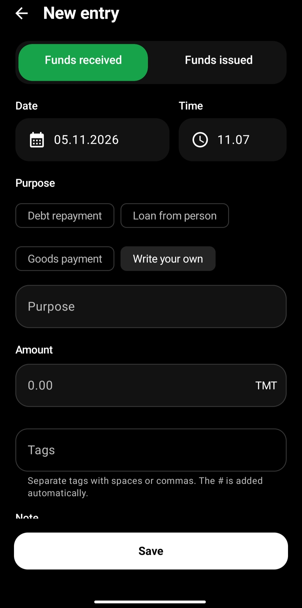
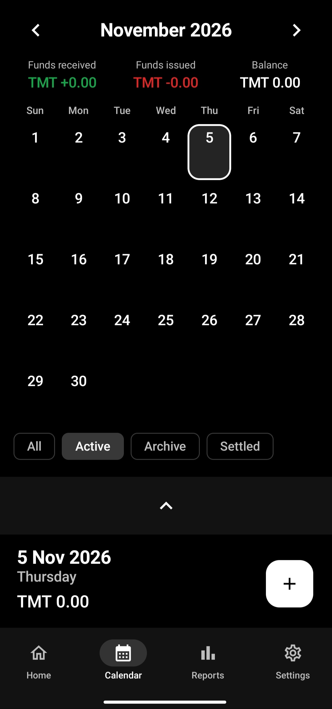
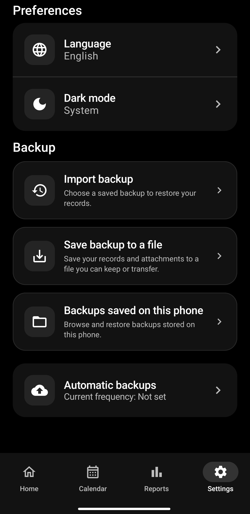
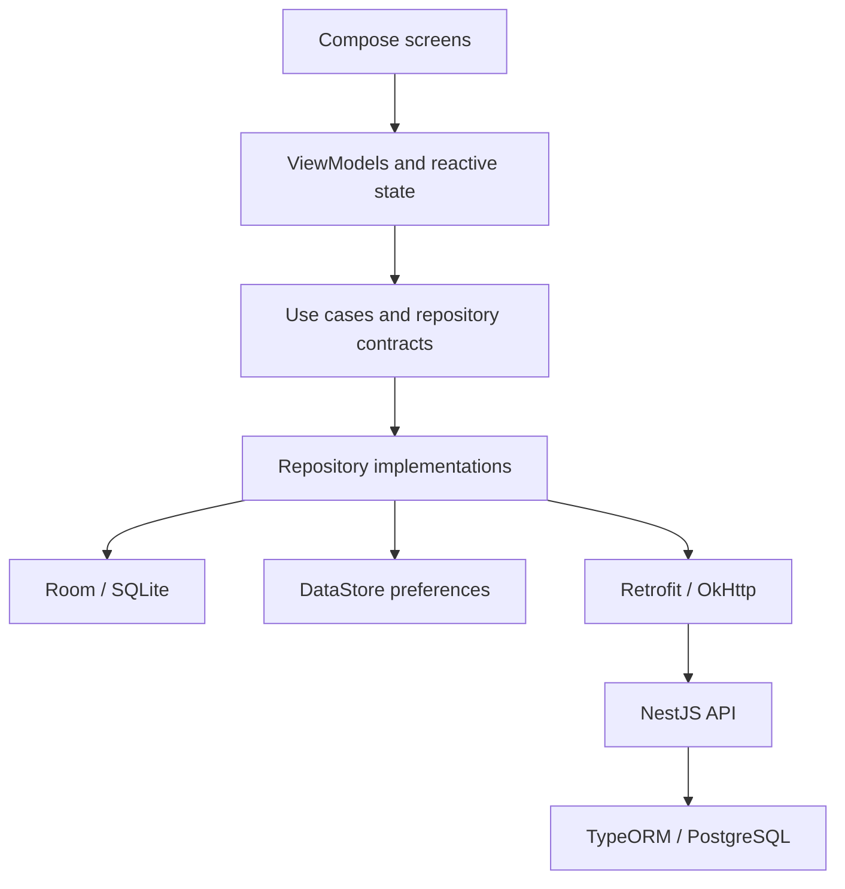

<div align="center">

# Netije

### A clearer picture of every loan, payment, and balance.

A native Android app for managing personal debts and loans, built with Kotlin, Jetpack Compose, and a local database, with a companion NestJS API.


[](LICENSE)

[Screenshots](#screenshots) · [Features](#features) · [Engineering](#engineering) · [Run locally](#run-locally) · [Developer](#developer)

</div>

Netije brings people, transactions, and repayment history into one place. Record money received or issued, follow each person's balance, and turn your records into shareable reports. Core recordkeeping uses local storage, so it does not require a backend connection.

## Screenshots

A focused dark interface for recording transactions, browsing the calendar, and managing local backups.

<table>
  <tr>
    <th width="33%">Record a transaction</th>
    <th width="33%">See the month</th>
    <th width="33%">Make it yours</th>
  </tr>
  <tr>
    <td align="center" valign="top">
      <a href="docs/screenshots/01-new-entry.jpg"></a>
    </td>
    <td align="center" valign="top">
      <a href="docs/screenshots/02-calendar.jpg"></a>
    </td>
    <td align="center" valign="top">
      <a href="docs/screenshots/03-preferences-backup.jpg"></a>
    </td>
  </tr>
  <tr>
    <td align="center">Choose a purpose, add tags, and record money received or issued.</td>
    <td align="center">Browse dates, review totals, and filter by transaction status.</td>
    <td align="center">Set your language and theme, then save or restore your records.</td>
  </tr>
</table>

Select any screenshot to view the full-size image.

## Features

| Capability | What it offers |
| --- | --- |
| People and balances | Keep contact details alongside transaction histories and per-person totals. |
| Transaction management | Record received and issued amounts, notes, dates, attachments, and searchable tags. |
| Repayment tracking | Link related payments to an original transaction and see the group's balance. |
| Record lifecycle | Mark transactions as active, archived, or settled, with status filters. |
| Calendar | Browse dated transactions and daily totals. |
| Reports | Generate person, summary, and transaction reports; export PDF, XLSX, or CSV and share through Android. |
| Backup and restore | Export and import JSON backups, including supported attachment data; schedule local backups with WorkManager. |
| Personalization | Choose English, Russian, Turkmen, or Turkish, with light, dark, and system theme options. |

The current app uses Turkmen manat (**TMT**) for its currency setting.

## Engineering

This project demonstrates mobile development across UI, persistence, platform integrations, and API integration. The Android code separates presentation, domain contracts, and data implementations, with Hilt connecting the layers.



- **Reactive UI:** Coroutines and Flow connect stored records, search queries, and filters to ViewModel state.
- **Persistence evolution:** Room schemas are versioned in the repository alongside database migrations.
- **Data continuity:** Transaction mapping preserves change history, related payments, and tags when merging remote records; pending status updates have dedicated synchronization handling.
- **Android integration:** Contact access, camera and image attachments, FileProvider sharing, and scheduled background work support everyday workflows.
- **Document generation:** Local PDF, spreadsheet, and CSV generation lets users export records without relying on server-side rendering.
- **Verification:** JVM and instrumented tests cover domain rules, storage, backups, exports, localization, and responsive layouts. Backend tests cover transaction behavior, tags, and related payments.

### Technology

| Layer | Stack |
| --- | --- |
| Android UI | Jetpack Compose, Material 3, Navigation Compose |
| Application logic | Kotlin, ViewModel, Coroutines, Flow, Hilt |
| Local data | Room, SQLite, Preferences DataStore |
| Networking and images | Retrofit, OkHttp, Gson, Coil |
| Background work | WorkManager |
| Backend | TypeScript, NestJS, TypeORM, PostgreSQL |
| Authentication | Google sign-in integration and JWT API authentication |
| Tests | JUnit, AndroidX Test, Compose UI Test, Node.js test runner |

### Repository layout

```text
app/
  schemas/                     Versioned Room database schemas
  src/main/java/com/example/netije/
    data/                      Local storage, API clients, backups, repositories
    domain/                    Models, repository contracts, use cases
    presentation/              Screens, components, ViewModels, navigation, exports
    di/                        Hilt dependency configuration
    ui/theme/                  Compose theme and typography
  src/test/                    JVM tests
  src/androidTest/             Device and Compose UI tests
backend/
  src/modules/                 Auth, people, transactions, sync, reports
  test/                        Backend behavior tests
docs/                          Setup and screenshot guidance
```

## Run locally

Clone the repository and open it in Android Studio:

```bash
git clone https://github.com/dawutdeveloper/netije.git
cd netije
```

Install **Android SDK Platform 37** and use the checked-in Gradle wrapper. The project targets Java 17 bytecode; its Gradle daemon configuration requests **JDK 25**. Minimum supported device version is **Android 7.0 / API 24**.

Build and install the debug app on Windows:

```powershell
.\gradlew.bat :app:assembleDebug
.\gradlew.bat :app:installDebug
```

On macOS or Linux, use `bash ./gradlew` in place of `.\gradlew.bat`.

The local recordkeeping workflow can run without configuring Google sign-in. For backend setup, OAuth configuration, and release signing, see the [development guide](docs/DEVELOPMENT.md).

### Run checks

```powershell
.\gradlew.bat :app:testDebugUnitTest :app:lintDebug
.\gradlew.bat :app:connectedDebugAndroidTest
```

The instrumented tests require a connected Android device or emulator. For backend checks, run `npm install` followed by `npm test` inside `backend/`.

### Integration status

Google sign-in and remote data operations require a configured backend and matching OAuth client ID. Remote synchronization is implemented through repository operations; a general background synchronization queue is not provided. Google Drive backup and restore methods are currently stubs; local JSON backup and restore are implemented.

## Developer

Built by **[dawutdeveloper](https://github.com/dawutdeveloper)**, a mobile application developer focused on native Android experiences, maintainable application architecture, and practical product workflows.

Explore the implementation to see the work behind the interface: reactive state, evolving local data models, repayment relationships, multilingual exports, and Android platform integrations.

## License

Released under the [MIT License](LICENSE).
