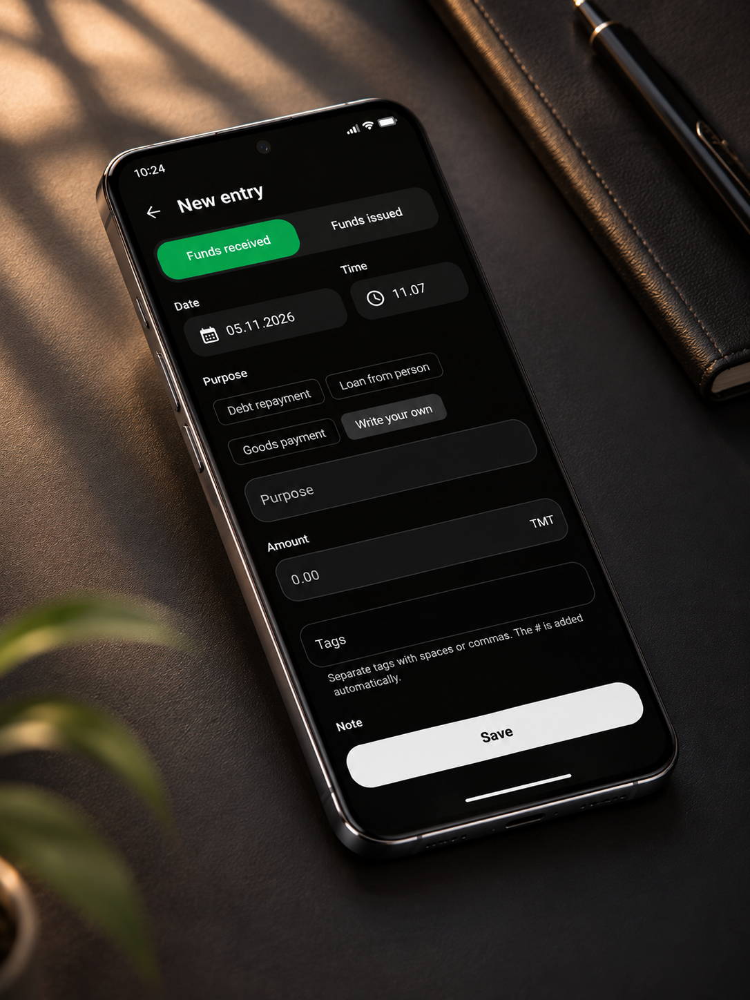
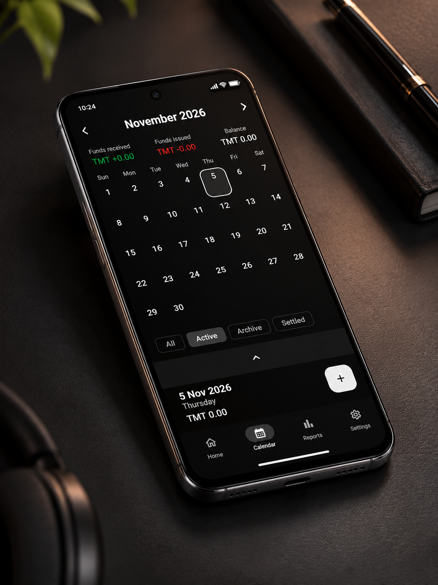
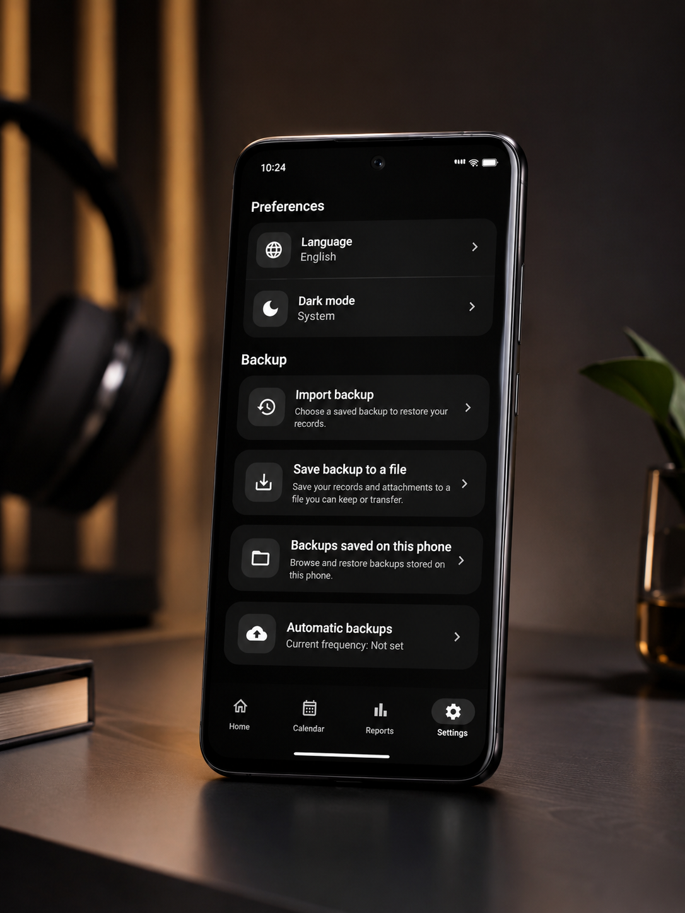

[English](../README.md) | [Русский](README.ru.md) | [Türkçe](README.tr.md)

# Gazna

### Все займы, платежи и остатки — в одном месте.

Gazna — нативное приложение для Android, которое помогает вести учёт личных долгов и займов. Приложение написано на Kotlin с интерфейсом на Jetpack Compose и локальной базой данных. В репозитории также есть серверная часть на NestJS.

Записывайте полученные и выданные суммы, просматривайте баланс каждого человека, отслеживайте возвраты и делитесь отчётами. Основные функции учёта работают локально и не требуют подключения к серверу.

[Скриншоты](#скриншоты) · [Возможности](#возможности) · [Архитектура](#архитектура) · [Локальный запуск](#локальный-запуск) · [Разработчик](#разработчик)

## Скриншоты

Интерфейс в тёмной теме: создание операции, календарь и настройки резервного копирования. Нажмите на изображение, чтобы открыть его в полном размере.

| Новая операция | Календарь | Настройки и резервные копии |
| --- | --- | --- |
| [](screenshots/01-new-entry.png) | [](screenshots/02-calendar.png) | [](screenshots/03-preferences-backup.png) |

## Возможности

| Функция | Описание |
| --- | --- |
| Люди и балансы | Контактные данные, история операций и итоговые суммы по каждому человеку. |
| Учёт операций | Полученные и выданные суммы, заметки, даты, вложения и теги с возможностью поиска. |
| Возврат долгов | Связь платежей с исходной операцией и расчёт общего остатка по группе. |
| Статусы записей | Активные, архивные и закрытые операции с фильтрацией по статусу. |
| Календарь | Просмотр операций по датам и итогов за день. |
| Отчёты | Отчёты по человеку, сводные отчёты и отчёты по операциям; экспорт в PDF, XLSX или CSV и отправка через Android. |
| Резервное копирование | Экспорт и импорт JSON-копий, включая поддерживаемые данные вложений; автоматическое локальное копирование через WorkManager. |
| Персонализация | Английский, русский, туркменский и турецкий языки; светлая, тёмная и системная темы. |

В текущей версии используется туркменский манат (**TMT**).

## Архитектура

Код Android разделён на слой представления, доменные модели и контракты, а также реализации работы с данными. Hilt обеспечивает внедрение зависимостей между слоями.

```text
Экраны Compose → ViewModel → Сценарии использования и интерфейсы репозиториев
→ Реализации репозиториев → Room / DataStore / Retrofit
→ Сервер NestJS → PostgreSQL
```

- Coroutines и Flow связывают данные, поиск и фильтры с состоянием интерфейса.
- Схемы Room и миграции хранятся в репозитории.
- При объединении удалённых записей сохраняются история изменений, связанные платежи и теги; предусмотрена обработка ожидающих синхронизации статусов.
- Интеграции Android включают контакты, камеру, вложения, FileProvider и фоновые задачи.
- PDF, таблицы и CSV создаются локально.
- Модульные и инструментальные тесты проверяют бизнес-правила, хранение данных, резервные копии, экспорт, локализацию и адаптивные экраны. Серверные тесты проверяют операции, теги и связанные платежи.

| Слой | Технологии |
| --- | --- |
| Интерфейс | Jetpack Compose, Material 3, Navigation Compose |
| Логика приложения | Kotlin, ViewModel, Coroutines, Flow, Hilt |
| Локальные данные | Room, SQLite, Preferences DataStore |
| Сеть и изображения | Retrofit, OkHttp, Gson, Coil |
| Фоновые задачи | WorkManager |
| Сервер | TypeScript, NestJS, TypeORM, PostgreSQL |
| Аутентификация | Интеграция входа через Google и JWT |
| Тестирование | JUnit, AndroidX Test, Compose UI Test, тестовый раннер Node.js |

Основной код Android находится в `app/src/main/java/com/gazna/`: `presentation/` содержит экраны и ViewModel, `domain/` — модели и сценарии использования, `data/` — хранилища, API и репозитории, `di/` — конфигурацию Hilt. Сервер расположен в `backend/`, документация — в `docs/`.

## Локальный запуск

Клонируйте репозиторий и откройте его в Android Studio:

```bash
git clone https://github.com/dawutdeveloper/netije.git
cd netije
```

Установите **Android SDK Platform 37** и используйте Gradle wrapper из репозитория. Проект компилируется в байт-код Java 17, а конфигурация демона Gradle запрашивает **JDK 25**. Минимальная версия Android — **7.0 / API 24**.

Сборка и установка отладочной версии в Windows:

```powershell
.\gradlew.bat :app:assembleDebug
.\gradlew.bat :app:installDebug
```

В macOS и Linux используйте `bash ./gradlew` вместо `.\gradlew.bat`.

Для локального учёта настройка входа через Google не требуется. Настройка сервера, OAuth и подписи релизной сборки описана в [руководстве разработчика на английском языке](DEVELOPMENT.md).

### Проверки

```powershell
.\gradlew.bat :app:testDebugUnitTest :app:lintDebug
.\gradlew.bat :app:connectedDebugAndroidTest
```

Для инструментальных тестов необходимо подключённое устройство или эмулятор. Для проверки сервера выполните `npm install`, затем `npm test` в каталоге `backend/`.

### Состояние интеграций

Вход через Google и удалённые операции требуют настроенного сервера и соответствующего идентификатора клиента OAuth. Синхронизация реализована в операциях репозиториев; общей очереди фоновой синхронизации нет. Методы резервного копирования и восстановления через Google Drive пока являются заглушками. Локальный экспорт и импорт JSON-копий реализованы.

Название приложения — Gazna, пространство имён исходного кода — `com.gazna`. Идентификатор установленного приложения сохранён: `com.example.netije`. Имена существующих хранилищ также сохранены для совместимости с прежними данными. Адрес репозитория остаётся прежним.

## Разработчик

Автор — **[dawutdeveloper](https://github.com/dawutdeveloper)**, разработчик мобильных приложений, специализирующийся на нативных Android-интерфейсах, поддерживаемой архитектуре и практических сценариях использования.

В реализации можно изучить реактивное состояние, развитие локальных моделей данных, связи между займами и возвратами, многоязычный экспорт и интеграции с платформой Android.

## Лицензия

Проект распространяется по [лицензии MIT](../LICENSE).
