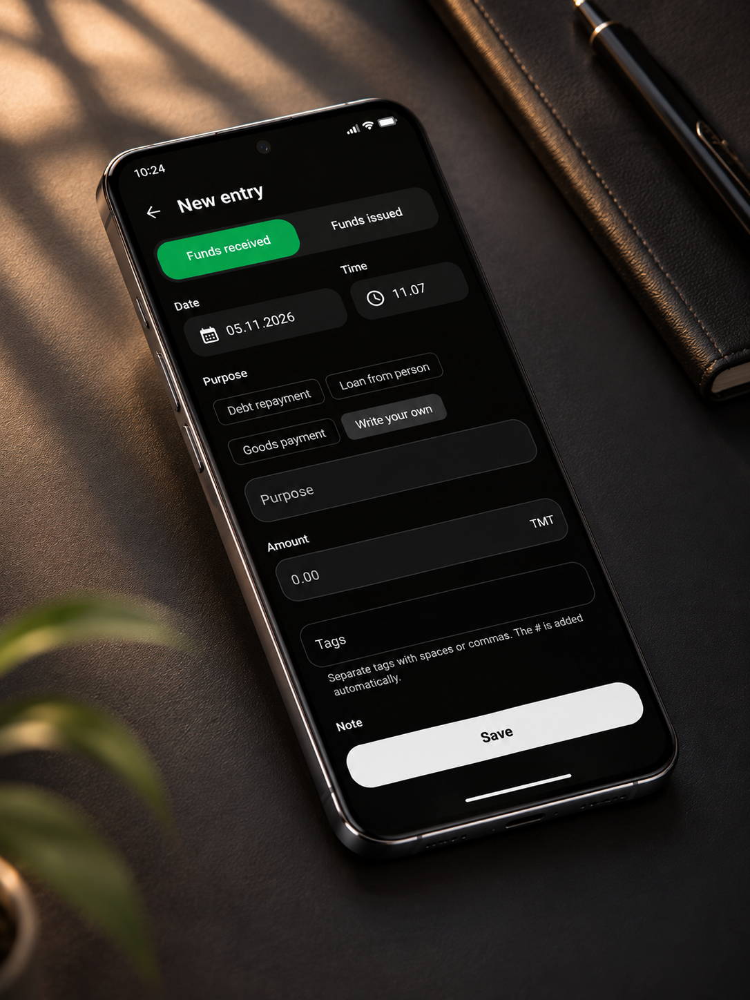
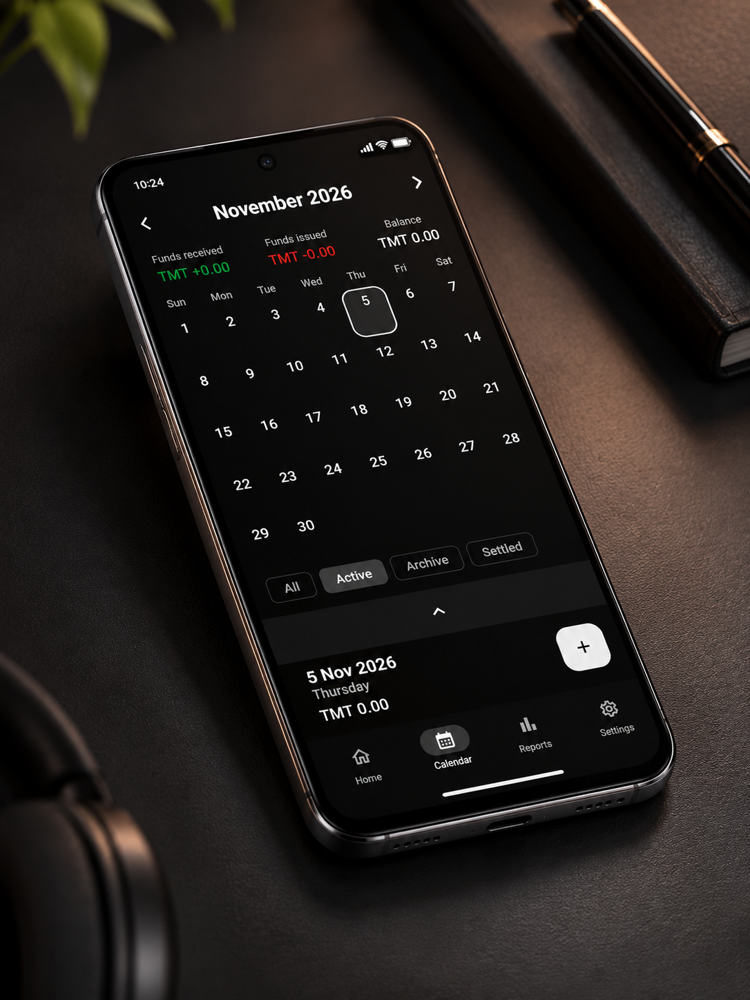
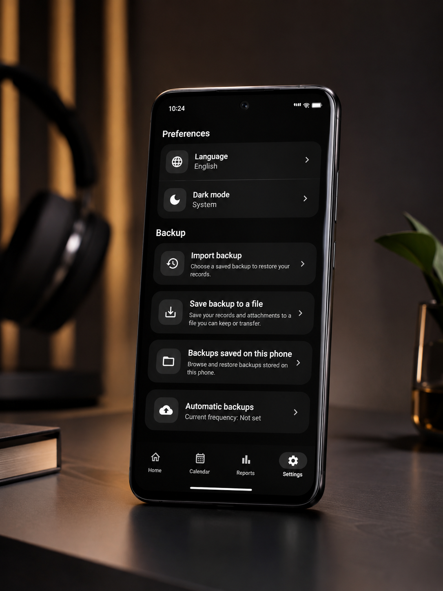

[English](../README.md) | [Русский](README.ru.md) | [Türkçe](README.tr.md)

# Gazna

### Her borç, ödeme ve bakiye için daha net bir görünüm.

Gazna, kişisel borç ve alacakları takip etmek için geliştirilmiş bir Android uygulamasıdır. Kotlin, Jetpack Compose ve yerel veritabanı kullanır. Depoda ayrıca NestJS ile geliştirilmiş bir sunucu uygulaması bulunur.

Alınan ve verilen tutarları kaydedin, her kişinin bakiyesini görün, geri ödemeleri takip edin ve raporlarınızı paylaşın. Temel kayıt işlemleri yerel depolama kullanır ve sunucu bağlantısı gerektirmez.

[Ekran görüntüleri](#ekran-görüntüleri) · [Özellikler](#özellikler) · [Mimari](#mimari) · [Yerel ortamda çalıştırma](#yerel-ortamda-çalıştırma) · [Geliştirici](#geliştirici)

## Ekran görüntüleri

Koyu temada işlem kaydı, takvim ve yedekleme ayarları. Tam boyutta görüntülemek için görsele tıklayın.

| Yeni işlem | Takvim | Ayarlar ve yedekleme |
| --- | --- | --- |
| [](screenshots/01-new-entry.png) | [](screenshots/02-calendar.png) | [](screenshots/03-preferences-backup.png) |

## Özellikler

| Özellik | Açıklama |
| --- | --- |
| Kişiler ve bakiyeler | İletişim bilgileri, işlem geçmişi ve kişi bazında toplamlar. |
| İşlem yönetimi | Alınan ve verilen tutarlar, notlar, tarihler, ekler ve aranabilir etiketler. |
| Geri ödeme takibi | Ödemeleri ilk işlemle ilişkilendirme ve işlem grubunun kalan bakiyesini görme. |
| Kayıt durumları | Aktif, arşivlenmiş ve kapatılmış işlemler; duruma göre filtreleme. |
| Takvim | Tarihe göre işlemleri ve günlük toplamları görüntüleme. |
| Raporlar | Kişi, özet ve işlem raporları; PDF, XLSX veya CSV olarak dışa aktarma ve Android üzerinden paylaşma. |
| Yedekleme ve geri yükleme | Desteklenen ek verileriyle birlikte JSON yedeklerini dışa ve içe aktarma; WorkManager ile zamanlanmış yerel yedekleme. |
| Kişiselleştirme | İngilizce, Rusça, Türkmence ve Türkçe; açık, koyu ve sistem teması seçenekleri. |

Mevcut sürümde para birimi olarak Türkmenistan manatı (**TMT**) kullanılır.

## Mimari

Android kodu; sunum katmanı, alan modelleri ve arayüzleri ile veri katmanı uygulamalarına ayrılmıştır. Katmanlar arasındaki bağımlılıklar Hilt ile yönetilir.

```text
Compose ekranları → ViewModel → Kullanım senaryoları ve repository arayüzleri
→ Repository uygulamaları → Room / DataStore / Retrofit
→ NestJS sunucusu → PostgreSQL
```

- Coroutines ve Flow; kayıtları, aramayı ve filtreleri arayüz durumuna bağlar.
- Room şemaları ve veritabanı geçişleri depoda sürümlenir.
- Uzak kayıtlar birleştirilirken değişiklik geçmişi, ilişkili ödemeler ve etiketler korunur; eşitleme bekleyen durum değişiklikleri ayrıca işlenir.
- Android entegrasyonları; kişiler, kamera, ekler, FileProvider ile paylaşım ve arka plan görevlerini kapsar.
- PDF, elektronik tablo ve CSV dosyaları yerel olarak oluşturulur.
- Birim ve cihaz testleri; iş kurallarını, depolamayı, yedeklemeyi, dışa aktarmayı, yerelleştirmeyi ve farklı ekran boyutlarını kapsar. Sunucu testleri işlemleri, etiketleri ve ilişkili ödemeleri doğrular.

| Katman | Teknolojiler |
| --- | --- |
| Arayüz | Jetpack Compose, Material 3, Navigation Compose |
| Uygulama mantığı | Kotlin, ViewModel, Coroutines, Flow, Hilt |
| Yerel veriler | Room, SQLite, Preferences DataStore |
| Ağ ve görseller | Retrofit, OkHttp, Gson, Coil |
| Arka plan görevleri | WorkManager |
| Sunucu | TypeScript, NestJS, TypeORM, PostgreSQL |
| Kimlik doğrulama | Google ile giriş entegrasyonu ve JWT |
| Testler | JUnit, AndroidX Test, Compose UI Test, Node.js test çalıştırıcısı |

Android kaynak kodu `app/src/main/java/com/gazna/` altındadır: `presentation/` ekranları ve ViewModel sınıflarını, `domain/` modelleri ve kullanım senaryolarını, `data/` depolama, API ve repository uygulamalarını, `di/` ise Hilt yapılandırmasını içerir. Sunucu `backend/`, belgeler `docs/` dizinindedir.

## Yerel ortamda çalıştırma

Depoyu klonlayın ve Android Studio ile açın:

```bash
git clone https://github.com/dawutdeveloper/netije.git
cd netije
```

**Android SDK Platform 37** paketini yükleyin ve depodaki Gradle wrapper dosyalarını kullanın. Proje Java 17 bayt kodunu hedefler; Gradle daemon yapılandırması **JDK 25** ister. Desteklenen en düşük Android sürümü **7.0 / API 24** düzeyidir.

Windows üzerinde hata ayıklama sürümünü derleyip yüklemek için:

```powershell
.\gradlew.bat :app:assembleDebug
.\gradlew.bat :app:installDebug
```

macOS veya Linux üzerinde `.\gradlew.bat` yerine `bash ./gradlew` kullanın.

Yerel kayıt işlemleri için Google ile giriş yapılandırması gerekmez. Sunucu kurulumu, OAuth ve sürüm imzalama bilgileri için [İngilizce geliştirme kılavuzuna](DEVELOPMENT.md) bakın.

### Kontroller

```powershell
.\gradlew.bat :app:testDebugUnitTest :app:lintDebug
.\gradlew.bat :app:connectedDebugAndroidTest
```

Cihaz testleri için bağlı bir Android cihazı veya emülatör gerekir. Sunucu kontrolleri için `backend/` dizininde önce `npm install`, ardından `npm test` çalıştırın.

### Entegrasyonların durumu

Google ile giriş ve uzak veri işlemleri, yapılandırılmış bir sunucu ve eşleşen OAuth istemci kimliği gerektirir. Eşitleme, repository işlemleri üzerinden uygulanmıştır; genel bir arka plan eşitleme kuyruğu bulunmaz. Google Drive yedekleme ve geri yükleme yöntemleri henüz uygulanmamıştır. Yerel JSON yedekleme ve geri yükleme kullanılabilir durumdadır.

Uygulamanın adı Gazna, kaynak kodunun ad alanı `com.gazna` olarak düzenlenmiştir. Yüklü uygulamanın kimliği `com.example.netije` olarak korunmuştur. Mevcut verilerle uyumluluk için depolama adları da korunmuştur. Deponun adresi değişmemiştir.

## Geliştirici

**[dawutdeveloper](https://github.com/dawutdeveloper)** tarafından geliştirilmiştir. Geliştirici; yerel Android deneyimlerine, bakımı kolay uygulama mimarisine ve günlük ihtiyaçlara yönelik iş akışlarına odaklanır.

Kodda reaktif durum yönetimini, gelişen yerel veri modellerini, borç ve geri ödeme ilişkilerini, çok dilli dışa aktarmayı ve Android platform entegrasyonlarını inceleyebilirsiniz.

## Lisans

Proje [MIT Lisansı](../LICENSE) ile sunulmaktadır.
